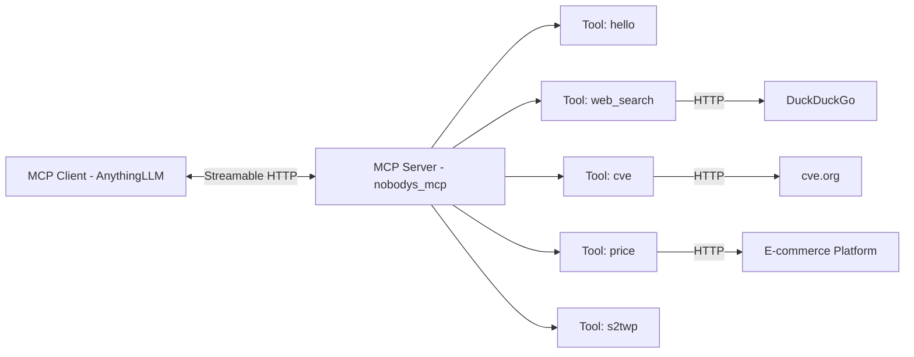

# nobodys_mcp — Specification

## Overview

MCP service for nobody.

## Goals

- 提供 `hello` tool：回傳 service 名稱、用途與版本資訊
- 提供 `web_search` tool：透過 DuckDuckGo 搜尋網頁並回傳結果
- 提供 `cve` tool：從 cve.org 取得最近的資安漏洞資訊
- 提供 `price` tool：從電商平台蒐集產品價格
- 提供 `s2twp` tool：將內文的簡體用詞改為台灣用詞

## Non-Goals

- 不作為 general-purpose web scraper
- 不支援需要登入才能存取的外部服務
- 不提供資料持久化 / 儲存功能

## Architecture

### High-Level Design



### Components

| Component | Responsibility |
|-----------|---------------|
| Server | MCP protocol handling, Streamable HTTP transport |
| Tools | Individual capabilities exposed to the LLM (`hello`, `web_search`, `cve`, `price`, `s2twp`) |
| External Clients | HTTP clients for DuckDuckGo, cve.org, e-commerce platforms |

## Tools

### `hello`

- **Description:** 回傳 service 名稱、用途與版本資訊
- **Input Schema:**
  ```json
  {
    "type": "object",
    "properties": {}
  }
  ```
- **Output:**
  ```json
  {
    "content": [{
      "type": "text",
      "text": "nobodys_mcp v0.1.0 - MCP service for nobody"
    }]
  }
  ```
- **Errors:** 無

---

### `web_search`

- **Description:** 透過 DuckDuckGo 搜尋網頁並回傳結果
- **Input Schema:**
  ```json
  {
    "type": "object",
    "properties": {
      "query": {
        "type": "string",
        "description": "搜尋關鍵字"
      },
      "max_results": {
        "type": "integer",
        "description": "回傳結果數量上限",
        "default": 5
      }
    },
    "required": ["query"]
  }
  ```
- **Output:**
  ```json
  {
    "content": [{
      "type": "text",
      "text": "1. Title - URL - Snippet\n2. ..."
    }]
  }
  ```
- **Errors:**
  - 網路連線失敗
  - DuckDuckGo 回應格式異常

---

### `cve`

- **Description:** 根據產品清單從 cve.org 查詢相關的資安漏洞
- **Input Schema:**
  ```json
  {
    "type": "object",
    "properties": {
      "products": {
        "type": "array",
        "items": { "type": "string" },
        "description": "產品名稱清單，例: [\"nginx\", \"openssl\"]"
      },
      "start_date": {
        "type": "string",
        "format": "date",
        "description": "起始日期 (YYYY-MM-DD)，例: \"2026-01-01\""
      },
      "end_date": {
        "type": "string",
        "format": "date",
        "description": "結束日期 (YYYY-MM-DD)，例: \"2026-11-26\""
      },
      "limit": {
        "type": "integer",
        "description": "每個產品回傳筆數上限",
        "default": 10
      }
    },
    "required": ["products"]
  }
  ```
- **Output:**
  ```json
  {
    "content": [{
      "type": "text",
      "text": "nginx:\n  CVE-2026-XXXX: Description (Severity: High)\n  ...\nopenssl:\n  CVE-2026-YYYY: Description (Severity: Critical)\n  ..."
    }]
  }
  ```
- **Errors:**
  - 網路連線失敗
  - cve.org API 不可用

---

### `price`

- **Description:** 根據產品型號從電商平台查詢價格
- **Input Schema:**
  ```json
  {
    "type": "object",
    "properties": {
      "model": {
        "type": "string",
        "description": "產品型號，例: \"RTX 4090\", \"MacBook Pro 16 M4\""
      },
      "max_price": {
        "type": "number",
        "description": "價格上限（含），例: 50000"
      }
    },
    "required": ["model"]
  }
  ```
- **Output:**
  ```json
  {
    "content": [{
      "type": "text",
      "text": "Product: XYZ - Price: $XXX (Source: ...)"
    }]
  }
  ```
- **Errors:**
  - 找不到產品
  - 電商平台回應異常

---

### `s2twp`

- **Description:** 將內文的簡體中文用詞轉換為台灣繁體中文用詞
- **Input Schema:**
  ```json
  {
    "type": "object",
    "properties": {
      "text": {
        "type": "string",
        "description": "要轉換的簡體中文文字"
      }
    },
    "required": ["text"]
  }
  ```
- **Output:**
  ```json
  {
    "content": [{
      "type": "text",
      "text": "轉換後的繁體中文文字"
    }]
  }
  ```
- **Errors:**
  - 輸入文字為空

## Transport & Configuration

- **Transport:** Streamable HTTP
- **Default endpoint:** `POST http://localhost:55851/mcp`

### Server Config (`config.json`)

```json
{
  "server_name": "nobodys_mcp",
  "version": "0.1.0",
  "host": "0.0.0.0",
  "port": 55851,
  "endpoint": "/mcp"
}
```

### Client Connection (AnythingLLM)

```json
{
  "mcpServers": {
    "nobodys_mcp": {
      "url": "http://<host>:55851/mcp"
    }
  }
}
```

## API / Protocol Compliance

- **MCP spec version:** `2025-03-26`
- **Protocol:** JSON-RPC 2.0
- **Transport:** Streamable HTTP
- **Session mode:** Stateless

### Required Methods

| Method | Purpose |
|--------|---------|
| `initialize` | 交換 capability 與 protocol version |
| `notifications/initialized` | Client 確認初始化完成 |
| `tools/list` | 回傳可用 tools 清單 |
| `tools/call` | 執行指定 tool |

### Declared Capabilities

```json
{
  "capabilities": {
    "tools": {}
  }
}
```

> 本 server 僅實作 `tools` capability，不提供 `resources` 或 `prompts`。

## Constraints & Assumptions

### Constraints

- **Language:** Rust (edition 2021)
- **MCP SDK:** `rmcp` crate
- **HTTP framework:** Axum（由 `rmcp` 內建 Streamable HTTP server）
- **無外部 API key** — DuckDuckGo、cve.org、電商平台皆為 public access / scrape
- **無 authentication / authorization** — 開放存取
- **單實例部署** — 不支援多節點 / clustering

### Assumptions

- 外部服務（DuckDuckGo、cve.org、電商）在執行時可用
- 網路連線穩定，無 proxy / firewall 阻擋 outbound HTTP
- Client（AnythingLLM）與 Server 位於同一 network 或可透過 HTTP 到達
- Tool 回應時間可接受同步 JSON response（無需 SSE streaming）

## Change Log

| Date | Change | Author |
|------|--------|--------|
| 2026-11-26 | Initial spec skeleton | ... |
